  

  

  &nbsp;
  &nbsp;
  

 

 

| Role | Highlights |
|---|---|
| **Operations Executive**, Junius International – Sweeto | Checked supplier invoices against pricing, POs and goods received · reconciled inventory in Excel · 2–3 monthly reports for the Director · 20+ customer and operational cases a month |
| **Personal Assistant to the Director**, Junius International – Sweeto | Gathered figures from operations, accounting and production for meeting reports · notes, action items and progress tracking |
| **Corporate Clients Executive**, Asia Commercial Bank (ACB) | Assisted in checking corporate client documents for completeness and accuracy · kept client information up to date across internal systems |
| **Teaching Assistant**, Dai Truong Phat · iMap English | Weekly and monthly progress reports for 50+ students |

 

  
  

| Project | Business result | Stack |
|---|---|---|
| [**Grocery Sales Analysis – FMCG**](https://github.com/annguyen68-crypto/grocery-sales-sql-analysis) · [Dashboard](https://public.tableau.com/app/profile/an.nguy.n.thu./vizzes) | Verified 6.76M transactions across 7 tables; KPI tree of net sales; 56% of products bring 80% of revenue and the ranking is driven by price, not volume; 4 recommendations | MySQL · window functions · Tableau |
| [**Netflix Content Catalog Analysis**](https://github.com/annguyen68-crypto/Netflix_project) | Cleaned and validated 8,807 titles; answered 8 business questions; 5 recommendations | Python · Pandas · Seaborn |

 

| Area | Tools |
|---|---|
| **Data & analysis** |       |
| **Visualization** |     |
| **Excel & Office** |    |
| **Certificates** |     |

 

